# API REST, tests Postman et documentation Swagger — AutoLoc

Note technique — Atelier 5

L'application écoute sur `http://localhost:8081` (`server.port` du projet ; l'énoncé utilise 8080). Le préfixe `/api` est défini une seule fois par `server.servlet.context-path=/api` : les contrôleurs déclarent `@RequestMapping("/contrats")`, `@RequestMapping("/agences")`…

## A. Endpoints

Chaque contrôleur (`web.controller`) est annoté `@RestController`, `@RequestMapping` et `@RequiredArgsConstructor`. Il dépend uniquement de l'interface `I…Service`, injectée par constructeur dans un champ `final`, et ne contient aucune logique métier : les 400 viennent de `IllegalArgumentException`, les 404 de `ResourceNotFoundException`, traduites par `GlobalExceptionHandler` (corps `{statut, message, horodatage}`).

| Contrôleur | Verbe et route | Service appelé | Succès | Erreurs |
|---|---|---|---|---|
| `ContratController` | GET /api/contrats | `findAll()` | 200 | — |
| | GET /api/contrats/{id} | `findById(id)` | 200 | 404 |
| | POST /api/contrats | `create(contrat)` | 201 | 400 |
| | PUT /api/contrats/{id} | `update(id, contrat)` | 200 | 400, 404 |
| | DELETE /api/contrats/{id} | `deleteById(id)` | 204 | 404 |
| `PaiementController` | GET /api/paiements | `findAll()` | 200 | — |
| | GET /api/paiements/{id} | `findById(id)` | 200 | 404 |
| | POST, PUT, DELETE /api/paiements… | — (non exposé) | — | 405 |
| `AgenceController` | GET /api/agences | `findAll()` | 200 | — |
| | GET /api/agences/{id} | `findById(id)` | 200 | 404 |
| | POST /api/agences | `create(agence)` | 201 | 400 |
| | PUT /api/agences/{id} | `update(id, agence)` | 200 | 400, 404 |
| | DELETE /api/agences/{id} | `deleteById(id)` | 204 | 404, 409 |
| `EmployeController` | GET /api/employes | `findAll()` | 200 | — |
| | GET /api/employes/{id} | `findById(id)` | 200 | 404 |
| | POST /api/employes | `create(employe)` | 201 | 400 |
| | PUT /api/employes/{id} | `update(id, employe)` | 200 | 400, 404 |
| | DELETE /api/employes/{id} | `deleteById(id)` | 204 | 404 |
| `VehiculeController` | GET /api/vehicules | `findAll()` | 200 | — |
| | GET /api/vehicules/{id} | `findById(id)` | 200 | 404 |
| | POST /api/vehicules | `create(vehicule)` | 201 | 400, 409 |
| | PUT /api/vehicules/{id} | `update(id, vehicule)` | 200 | 400, 404, 409 |
| | DELETE /api/vehicules/{id} | `deleteById(id)` | 204 | 404, 409 |
| `EquipementController` | GET /api/equipements | `findAll()` | 200 | — |
| | GET /api/equipements/{id} | `findById(id)` | 200 | 404 |
| | POST /api/equipements | `create(equipement)` | 201 | 400, 409 |
| | PUT /api/equipements/{id} | `update(id, equipement)` | 200 | 400, 404, 409 |
| | DELETE /api/equipements/{id} | `deleteById(id)` | 204 | 404, 409 |
| `ClientController` | GET /api/clients | `findAll()` | 200 | — |
| | GET /api/clients/{id} | `findById(id)` | 200 | 404 |
| | POST /api/clients | `create(client)` | 201 | 400, 409 |
| | PUT /api/clients/{id} | `update(id, client)` | 200 | 400, 404, 409 |
| | DELETE /api/clients/{id} | `deleteById(id)` | 204 | 404, 409 |
| `ReservationController` | GET /api/reservations | `findAll()` | 200 | — |
| | GET /api/reservations/{id} | `findById(id)` | 200 | 404 |
| | POST /api/reservations | `create(reservation)` | 201 | 400 |
| | PUT /api/reservations/{id} | `update(id, reservation)` | 200 | 400, 404 |
| | DELETE /api/reservations/{id} | `deleteById(id)` | 204 | 404 |
| `MaintenanceController` | GET /api/maintenances | `findAll()` | 200 | — |
| | GET /api/maintenances/{id} | `findById(id)` | 200 | 404 |
| | POST /api/maintenances | `create(maintenance)` | 201 | 400 |
| | PUT /api/maintenances/{id} | `update(id, maintenance)` | 200 | 400, 404 |
| | DELETE /api/maintenances/{id} | `deleteById(id)` | 204 | 404 |

**409 Conflict** : ajouté au `GlobalExceptionHandler` pour `DataIntegrityViolationException` — valeur unique déjà utilisée (email, numPermis, immatriculation, libellé) ou suppression d'une ligne encore référencée (agence qui a des employés). Sans ce gestionnaire, ces cas remontaient en 500.

## B. Annotations Jackson

| Association | Annotation retenue | Justification |
|---|---|---|
| `Contrat.paiements` / `Paiement.contrat` | `@JsonManagedReference("contrat-paiements")` / `@JsonBackReference("contrat-paiements")` | Composition (`cascade = ALL`) : les paiements sont écrits dans le JSON du contrat et y sont lus au POST ; la référence arrière est rétablie par Jackson, ce qui renseigne la clé étrangère `contrat_id_contrat`. |
| `Agence.vehicules`, `Agence.employes` | `@JsonIgnore` | Côté inverse : un véhicule ou un employé se crée seul et désigne son agence (`"agence": {"idAgence": 1}`). Exposer la liste ferait boucler Agence → Vehicule → Agence. |
| `Client.reservations`, `Vehicule.maintenances`, `Equipement.vehicules` | `@JsonIgnore` | Même raison : listes du côté inverse, l'enfant est créé seul. |
| `Reservation.contrat` | `@JsonIgnore` | Côté inverse du `@OneToOne` ; sans annotation : Reservation → Contrat → Reservation à l'infini. |
| `Vehicule.agence`, `Employe.agence`, `Reservation.client`, `Reservation.vehicule`, `Maintenance.vehicule`, `Contrat.reservation`, `Vehicule.equipements` | aucune | Côté propriétaire : la propriété doit rester lisible au POST (`{"client": {"idClient": 1}}`), sinon l'association ne serait jamais enregistrée. |
| Entités cibles d'un `@ManyToOne`/`@OneToOne` LAZY (`Agence`, `Client`, `Vehicule`, `Reservation`, `Contrat`) | `@JsonIgnoreProperties({"hibernateLazyInitializer", "handler"})` | Le proxy Hibernate expose ces deux propriétés techniques : sans l'annotation, `No serializer found … ByteBuddyInterceptor` (500). |

**`@JsonBackReference` ou `@JsonIgnore` ?** Les deux retirent la propriété du JSON en sortie, mais `@JsonBackReference` fonctionne en paire : à la lecture, Jackson remplit automatiquement la référence arrière avec l'objet parent (chaque `Paiement` reçoit son `Contrat`). `@JsonIgnore` ignore la propriété dans les deux sens, sans rien rétablir. C'est pourquoi `@JsonBackReference` ne convient pas à `Reservation.client` : la réservation n'est pas créée dans le JSON du client, la propriété serait simplement ignorée et la réservation enregistrée sans client.

**Configuration Jackson** (`application.properties`) :

- `spring.jackson.mapper.detect-parameter-names=false` — Jackson 3 lit les noms de paramètres et construisait les entités par le constructeur `@AllArgsConstructor` : un champ absent du JSON valait `null` au lieu de garder son initialisation (`"paiements": null` au lieu de `[]`, et `NullPointerException` possible sur `addPaiement`). Avec ce réglage, Jackson utilise le constructeur sans argument puis les setters.
- `spring.jackson.mapper.sort-properties-alphabetically=false` — champs JSON dans l'ordre de déclaration de l'entité (identifiant en premier).

## C. Postman et Swagger

| | Postman | Swagger UI |
|---|---|---|
| Rôle | **Tester** : requêtes enregistrées, rejouables, avec assertions. | **Documenter et explorer** : contrat OpenAPI généré depuis le code, toujours synchronisé. |
| Exemple dans l'atelier | Le scénario de cascade (créer un contrat avec 2 paiements → les paiements apparaissent dans `/paiements` → suppression du contrat → `GET /paiements/{id}` en 404) s'enchaîne grâce aux variables `contratCascadeId` et `paiementId` mémorisées par les scripts *After response*. Le Runner rejoue les 84 requêtes (102 assertions) en une seule exécution. | Sans écrire de requête, « Try it out » sur `GET /contrats/{id}` avec 9999 affiche la commande curl, le 404 et son corps JSON ; la section *Schemas* montre la structure de `Contrat` déduite de l'entité (`idContrat` int64, `dateSignature` date, `paiements` tableau…). |

Fichiers : `docs/postman/AutoLoc.postman_collection.json` (collection « AutoLoc », un dossier par contrôleur : requêtes nominales, au moins un 404 et un 400, 405 pour Paiement, 409 pour Client) et `docs/postman/local.postman_environment.json` (environnement « local », `baseUrl = http://localhost:8081`). Swagger UI : `http://localhost:8081/api/swagger-ui.html` ; description OpenAPI : `http://localhost:8081/api/v3/api-docs`.

## D. Anomalies SonarQube for IDE

Analyse du package `web.controller` (clic droit > SonarQube for IDE > Analyze) : **50 anomalies dans 10 fichiers** avant correction, **16 dans 8 fichiers** après.

| Règle | Explication | Correction |
|---|---|---|
| **java:S1710** — *Annotation repetitions should not be wrapped* (33 occurrences) | `@ApiResponse` est répétable depuis Java 8 : le conteneur `@ApiResponses({ … })` de l'énoncé est inutile et alourdit le code. | `@ApiResponse` répétée directement sur la méthode, import `ApiResponses` supprimé. Swagger UI affiche les mêmes réponses. |
| **java:S8688** — *Time-based ".now()" methods should specify a ZoneId or a Clock* (1) | `LocalDateTime.now()` dans `GlobalExceptionHandler` dépend implicitement du fuseau de la JVM. | `LocalDateTime.now(ZoneId.systemDefault())` : le fuseau utilisé est explicite. |
| **java:S4684** — *Persistent entities should not be used as arguments of @RequestMapping methods* (16, conservées) | Recevoir une entité JPA en `@RequestBody` expose au *mass assignment* : le client peut renseigner n'importe quel champ (identifiant, associations…). | Non corrigée volontairement : l'atelier expose les entités de façon provisoire. Les DTO du Chapitre 10 la feront disparaître. En attendant, les services refusent un identifiant à la création et `update()` ne recopie que les attributs modifiables. |

## E. Questions de compréhension

**1. Quel composant reçoit toutes les requêtes, et comment retrouve-t-il la méthode du contrôleur à appeler ?**
Le `DispatcherServlet`, point d'entrée unique de Spring MVC. Il interroge le `HandlerMapping`, qui a enregistré au démarrage chaque méthode annotée (`@GetMapping`, `@PostMapping`…) avec son verbe HTTP et son chemin (préfixe de `@RequestMapping` + sous-chemin). Le couple verbe + URL de la requête désigne la méthode, que le `HandlerAdapter` appelle après avoir converti `@PathVariable` et `@RequestBody`. La valeur retournée est convertie en JSON par Jackson.

**2. Pourquoi `ContratController` dépend-il de `IContratService` et non de `ContratRepository` ni de `ContratServiceImpl` ?**
Pas du repository : les règles métier (montant positif, pas d'identifiant à la création, recopie partielle dans `update`) sont dans le service, le contrôleur ne doit pas les contourner ni accéder aux données. Pas de l'implémentation : en dépendant de l'interface, le contrôleur ne connaît qu'un contrat ; Spring injecte le bean qui l'implémente, que l'on peut remplacer (autre implémentation, simulacre de test) sans modifier le contrôleur.

**3. Pourquoi un POST renvoie-t-il 201 et un DELETE 204 ? Pourquoi une ressource absente donne-t-elle 404 et non 500 ?**
201 Created signale qu'une nouvelle ressource a été créée (le corps contient sa représentation avec l'identifiant généré). 204 No Content signale un succès sans corps à renvoyer : la ressource n'existe plus. Une ressource absente est une erreur du client (identifiant inexistant), pas une panne du serveur : le service lève `ResourceNotFoundException`, que `GlobalExceptionHandler` traduit en 404. Sans ce gestionnaire, l'exception non traitée donnerait 500.

**4. Pourquoi `PaiementController` n'expose-t-il que des GET ? Quelle réponse reçoit un POST /api/paiements ?**
Un paiement est une partie du contrat (composition, `cascade = ALL`, `orphanRemoval`) : il est créé avec son contrat et supprimé avec lui ; `IPaiementService` est d'ailleurs en lecture seule. Un POST sur `/api/paiements` reçoit **405 Method Not Allowed** : la route existe, mais aucune méthode n'y est associée pour ce verbe.

**5. Quels risques présente l'exposition directe des entités JPA ? Pourquoi `Contrat.paiements` utilise-t-il `@JsonManagedReference` alors que `Agence.vehicules` utilise `@JsonIgnore` ?**
Risques : couplage de l'API au schéma de la base (renommer une colonne casse les clients), champs internes visibles, *mass assignment* (règle S4684 : le client peut fixer un identifiant ou une association), boucles de sérialisation et proxys LAZY à gérer par annotations. `Contrat.paiements` est une composition : les paiements sont créés dans le JSON de leur contrat, il faut donc les lire et rétablir leur référence au contrat, ce que fait la paire `@JsonManagedReference` / `@JsonBackReference`. Un véhicule, lui, est créé seul et désigne son agence par identifiant : la liste `Agence.vehicules` n'a pas à être lue ni écrite, `@JsonIgnore` suffit et coupe la boucle.

## F. Captures d'écran

Captures prises dans Postman (collection « AutoLoc », environnement « local »), Swagger UI et IntelliJ IDEA (SonarQube for IDE).

**6. Lister — `GET /api/contrats` : 200 OK, tableau JSON, test « Statut 200 » réussi**

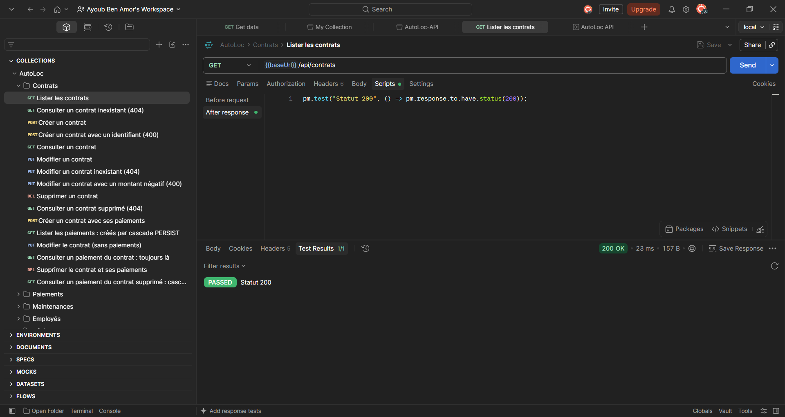

**7. Créer — `POST /api/contrats` : 201 Created, identifiant généré mémorisé dans `contratId`**

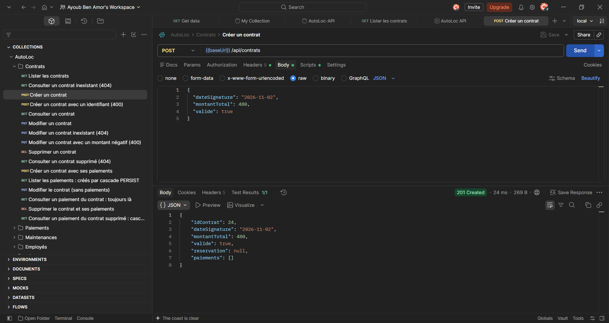

**8. Consulter — `GET /api/contrats/9999` : 404 Not Found, corps d'erreur JSON (statut, message, horodatage)**

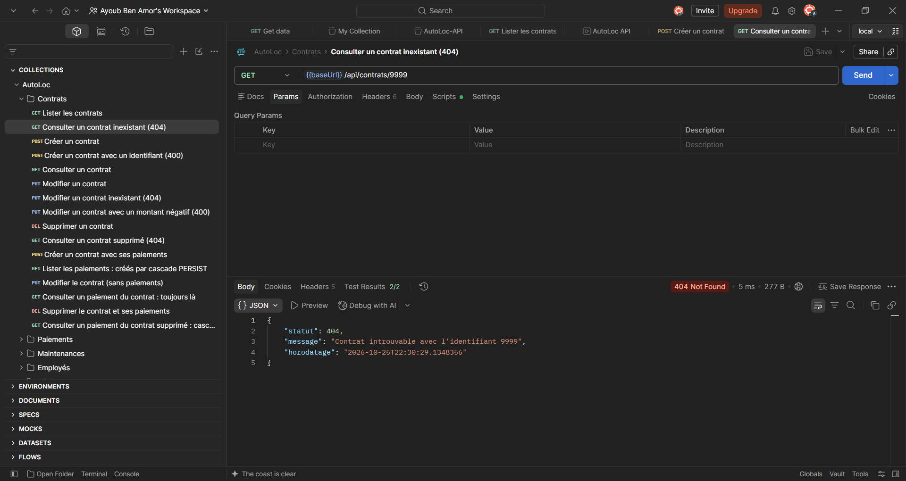

**9. Modifier — `PUT /api/contrats/{{contratId}}` : 200 OK, montant mis à jour (480 → 520)**

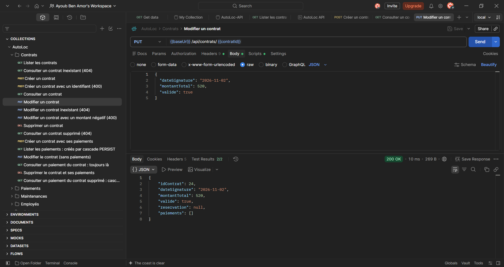

**10. Supprimer — `DELETE /api/contrats/{{contratId}}` : 204 No Content, sans corps**

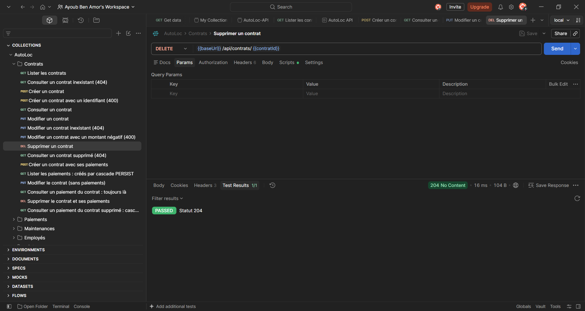

**11. Cascade — `POST /api/contrats` avec deux paiements : 201, paiements créés avec le contrat**

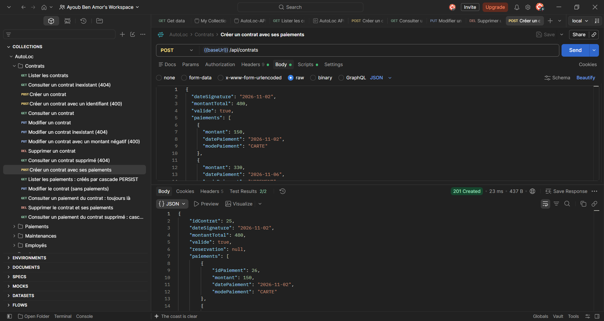

**12. Cascade PERSIST — `GET /api/paiements` : les deux paiements existent sans avoir été créés séparément**

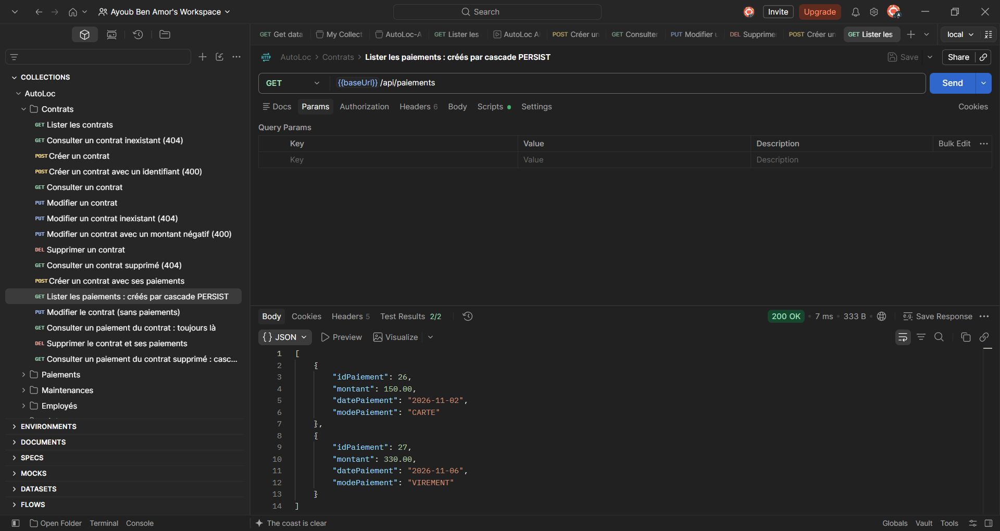

**13. Cascade REMOVE — après suppression du contrat, `GET /api/paiements/{id}` : 404**

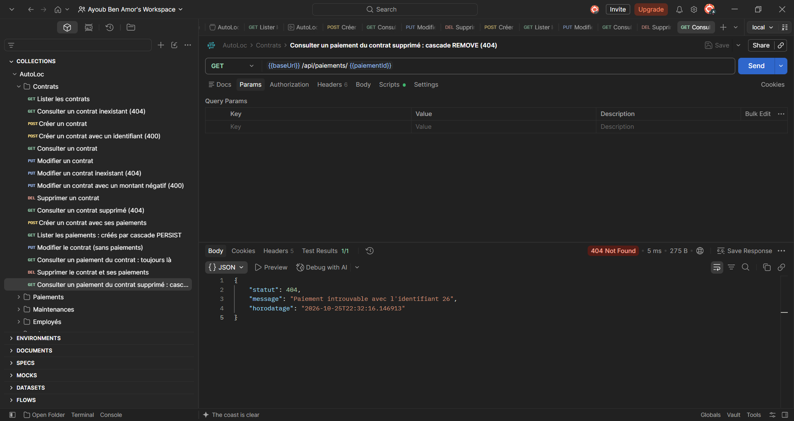

**14. Lecture seule — `POST /api/paiements` : 405 Method Not Allowed**

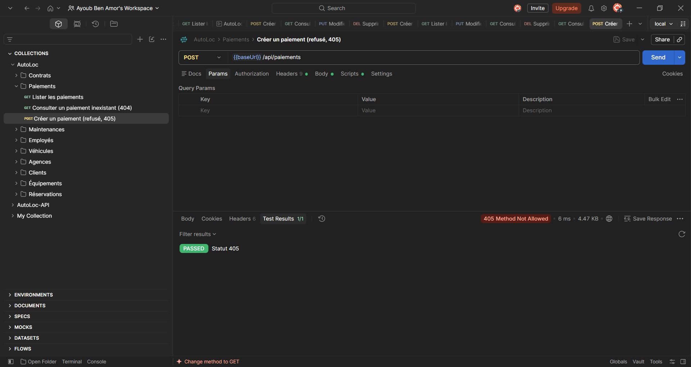

**15. Collection Runner : 84 requêtes, 102 tests réussis, 0 échec**

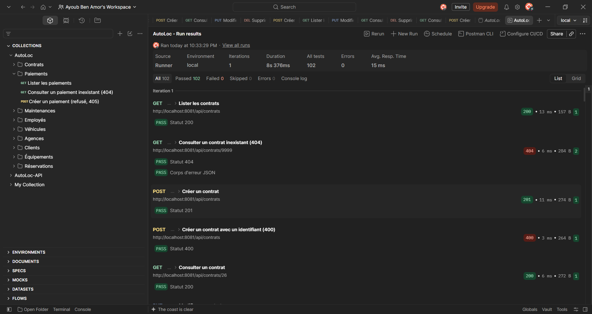

**16. Swagger UI — `/api/swagger-ui.html` : titre, version et description d'`OpenApiConfig`, un groupe `@Tag` par contrôleur**

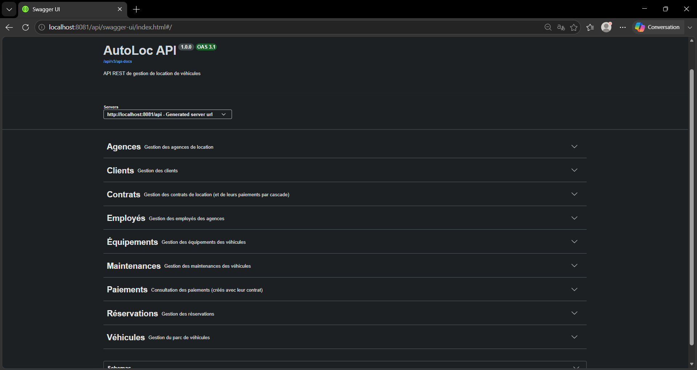

**17. Swagger UI — Try it out sur `GET /contrats/{id}` avec 9999 : requête curl, code 404 et corps**

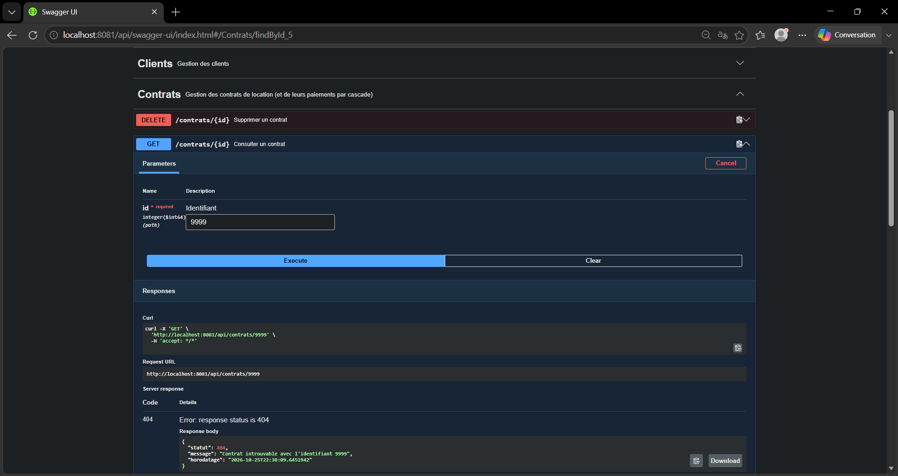

**18. Swagger UI — section Schemas : description de `Contrat` déduite de l'entité**

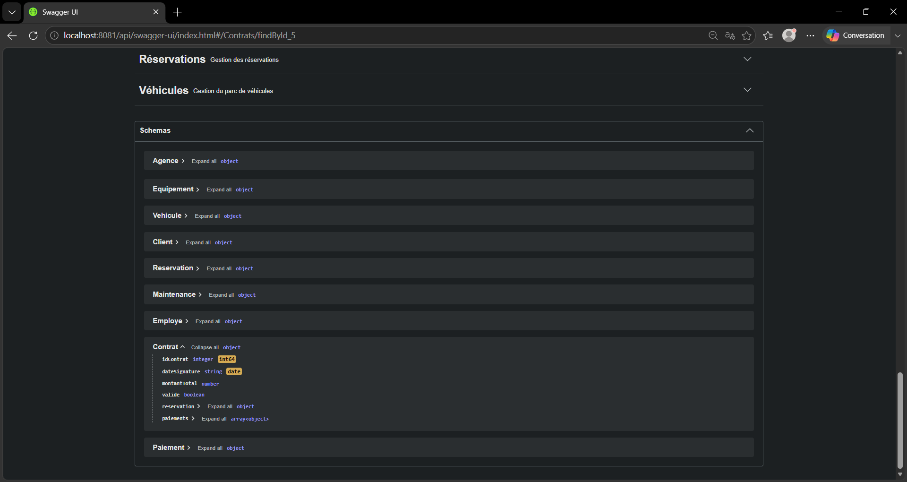

**19. SonarQube for IDE sur `web.controller` avant correction : 50 anomalies (S1710 sélectionnée)**

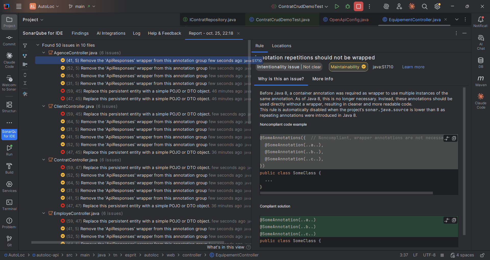

**20. Après correction : 16 anomalies, toutes S4684 (entité exposée), conservées jusqu'aux DTO**

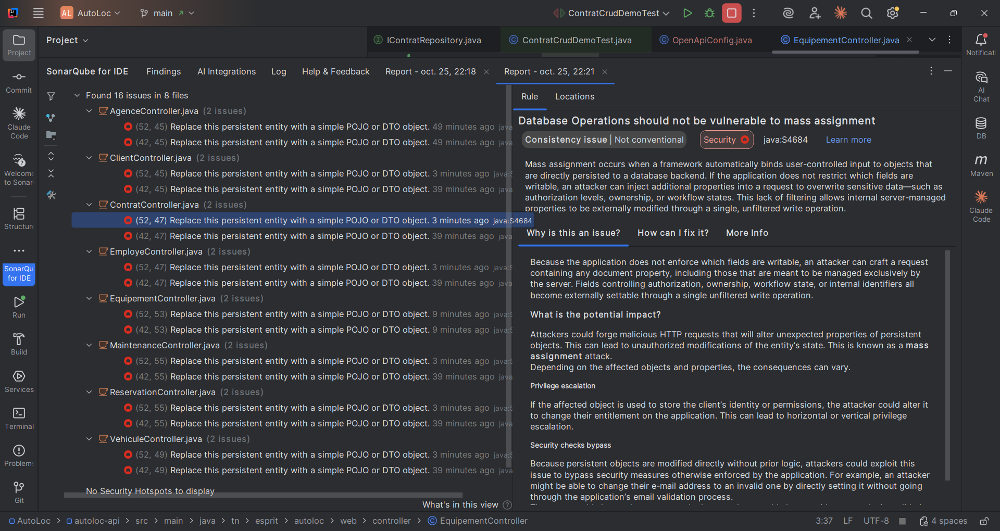
