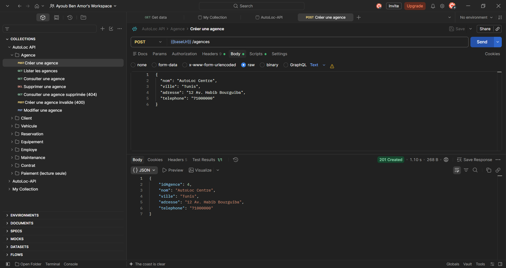
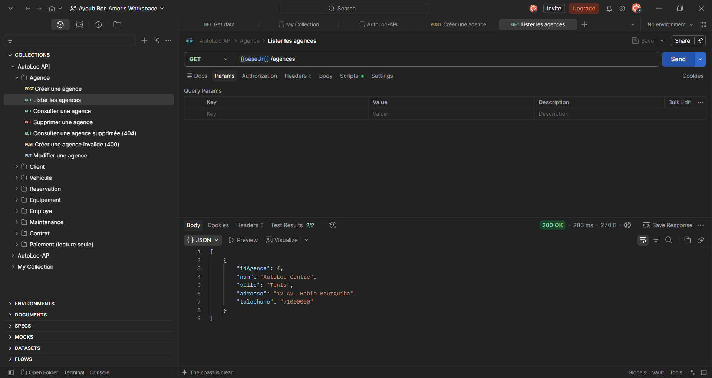
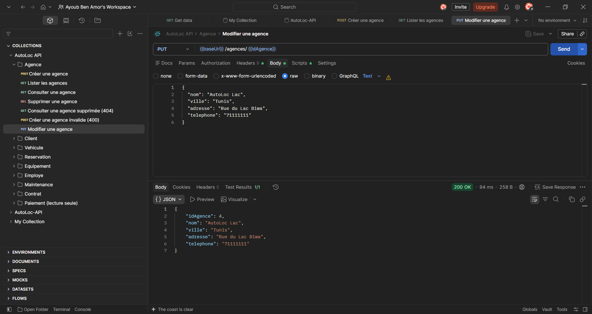
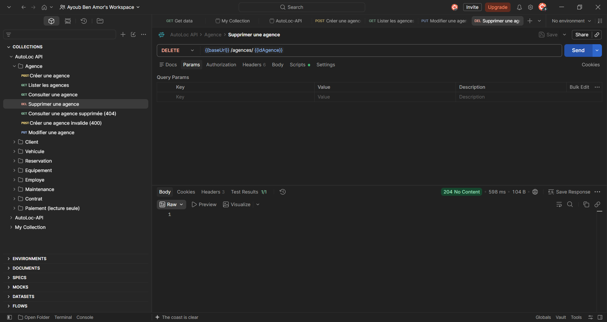
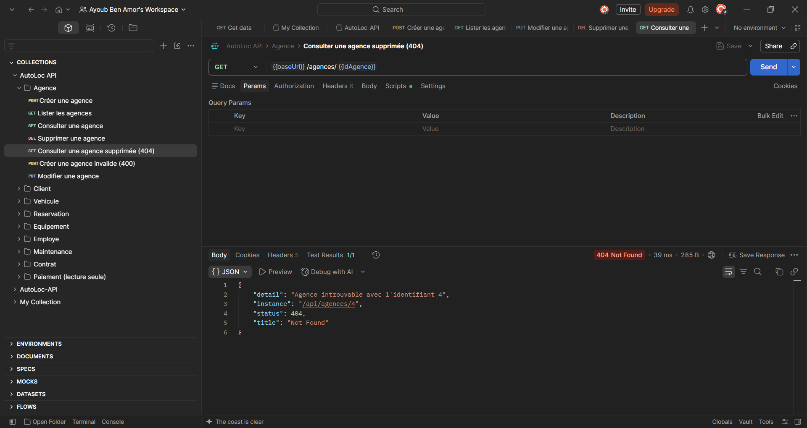
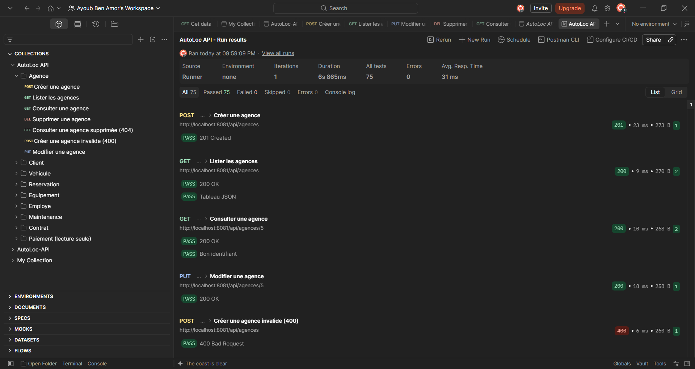

# Couche Web, contrôleurs REST — AutoLoc

Note technique — Atelier 5

## A. Contrôleurs

Chaque contrôleur est annoté `@RestController` et `@RequestMapping("/api/…")`, et reçoit son service par constructeur (`@RequiredArgsConstructor`, champ `final` typé par l'interface `I…Service`).

| Contrôleur | Base | Opérations |
|---|---|---|
| `AgenceController` | `/api/agences` | CRUD complet |
| `ClientController` | `/api/clients` | CRUD complet |
| `VehiculeController` | `/api/vehicules` | CRUD complet |
| `EquipementController` | `/api/equipements` | CRUD complet |
| `EmployeController` | `/api/employes` | CRUD complet |
| `MaintenanceController` | `/api/maintenances` | CRUD complet |
| `ReservationController` | `/api/reservations` | CRUD complet |
| `ContratController` | `/api/contrats` | CRUD complet |
| `PaiementController` | `/api/paiements` | Lecture seule : un paiement est créé et supprimé avec son contrat (composition) |

CRUD complet = `POST /` (201), `GET /` (200), `GET /{id}` (200), `PUT /{id}` (200), `DELETE /{id}` (204).

## B. Codes d'erreur

`GlobalExceptionHandler` (`@RestControllerAdvice`) traduit les exceptions des services en réponses `ProblemDetail` (RFC 9457) :

| Exception | Code HTTP | Cas |
|---|---|---|
| `ResourceNotFoundException` | 404 Not Found | identifiant inexistant |
| `IllegalArgumentException` | 400 Bad Request | règle de validation du service (champ obligatoire vide, date de fin avant la date de début, montant négatif…) |
| `DataIntegrityViolationException` | 409 Conflict | contrainte d'unicité (email, numPermis, immatriculation, libelle) |

## C. Sérialisation JSON des entités

Les entités sont encore exposées directement (les DTO arrivent à l'Atelier 6). Toutes les associations portent `@JsonIgnore` :

- les associations `LAZY` renverraient un proxy Hibernate que Jackson ne sait pas sérialiser ;
- les associations bidirectionnelles (`Agence` ↔ `Vehicule`, `Contrat` ↔ `Paiement`…) provoqueraient une boucle infinie ;
- les services ne gèrent pas encore les liens (Chapitre 9) : les accepter en entrée n'aurait aucun effet.

## D. Tests Postman

Collection : `docs/postman/AutoLoc-API.postman_collection.json` (59 requêtes, 75 assertions). Pour chaque ressource : création, liste, consultation, modification, création invalide (400), suppression, consultation après suppression (404), et un doublon (409) pour `Client`. L'identifiant créé est mémorisé dans une variable de collection et réutilisé par les requêtes suivantes.

## E. Captures d'écran

Captures prises dans Postman, application lancée depuis IntelliJ.

**6. `POST /api/agences` : 201 Created, identifiant attribué**

**7. `GET /api/agences` : 200 OK, liste des agences**

**8. `PUT /api/agences/{id}` : 200 OK, agence modifiée**

**9. `DELETE /api/agences/{id}` : 204 No Content**

**10. `GET /api/agences/{id}` après suppression : 404 Not Found au format `ProblemDetail`**

**11. Collection Runner : 59 requêtes, 75 tests réussis, 0 échec**

