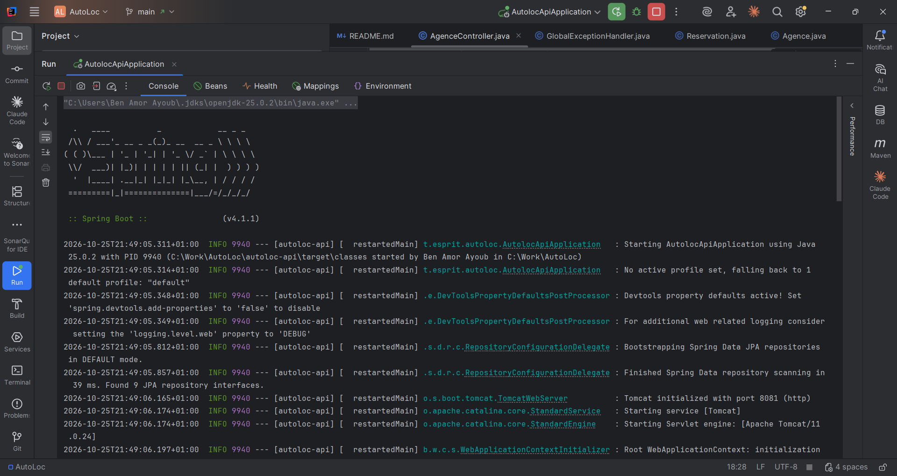
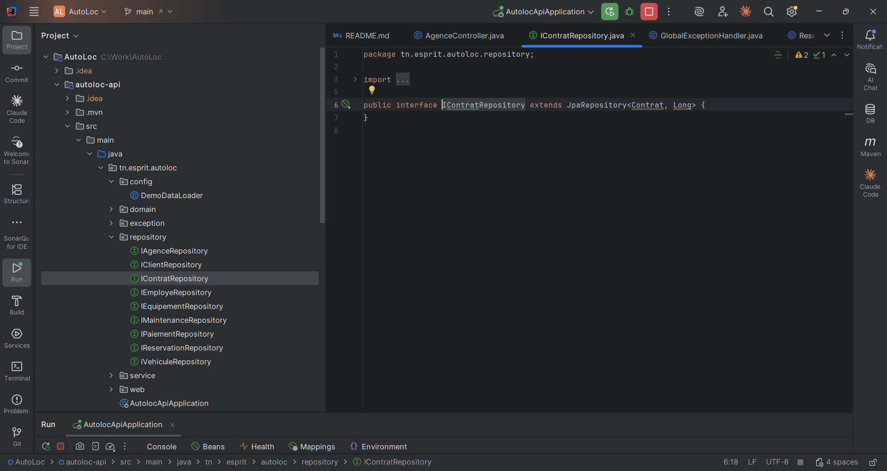
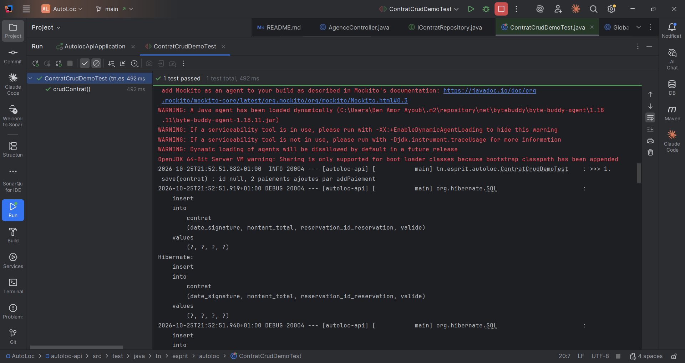
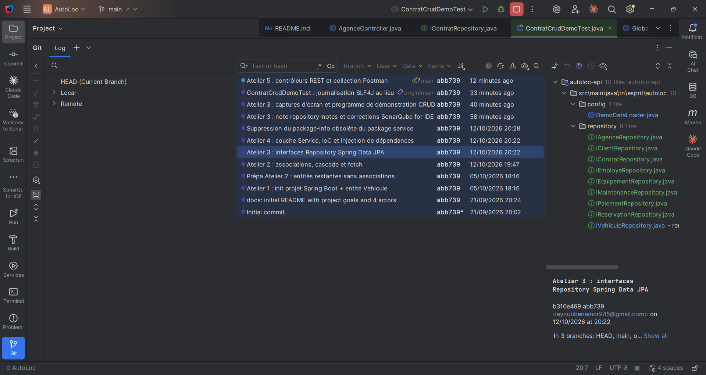
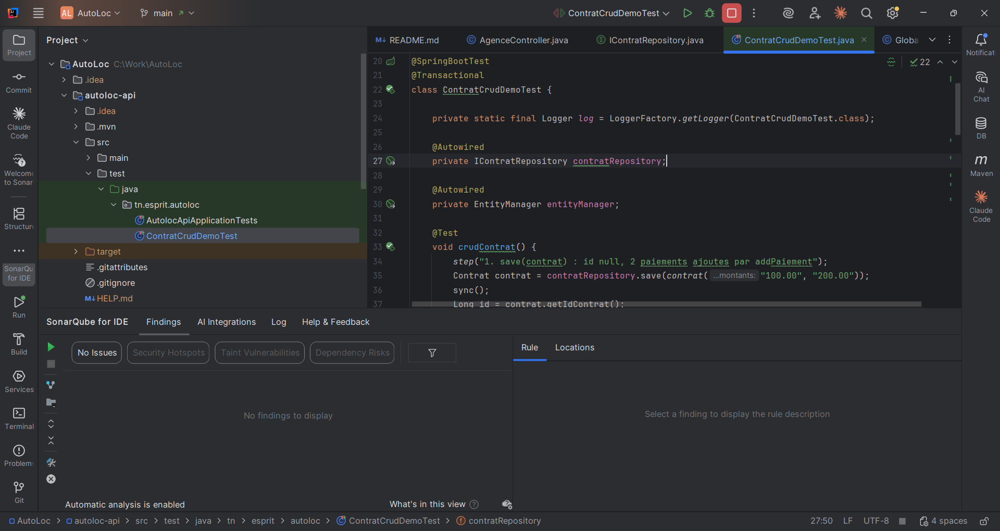

# Couche Repository Spring Data JPA — AutoLoc

Note technique — Atelier 3

## A. Choix des interfaces

Les neuf interfaces du package `tn.esprit.autoloc.repository` sont préfixées `I` (convention AutoLoc) et ne portent pas `@Repository` : Spring Data détecte toute interface qui étend `Repository` et génère son proxy au démarrage. Le démarrage affiche `Found 9 JPA repository interfaces`.

`IContratRepository` a d'abord été déclarée en `CrudRepository<Contrat, Long>` (étape 1), puis passée en `JpaRepository` comme les huit autres (étape 2).

| Interface | Étend | Justification |
|---|---|---|
| `IContratRepository` | `JpaRepository<Contrat, Long>` | CRUD complet, `findAll` renvoie une `List`, `saveAndFlush` disponible. La suppression d'un contrat passe par `deleteById` / `delete`, qui appliquent la cascade et l'`orphanRemoval` sur ses paiements. |
| `IPaiementRepository` | `JpaRepository<Paiement, Long>` | Utilisée pour **lire** les paiements (`findById`, `findAll`, tri et pagination). Composition : la création et la suppression d'un paiement passent par le contrat (`addPaiement` / `removePaiement`). |
| `IAgenceRepository` | `JpaRepository<Agence, Long>` | CRUD et listes ; tri et pagination utiles pour afficher le réseau d'agences. |
| `IEmployeRepository` | `JpaRepository<Employe, Long>` | CRUD et listes du personnel ; pagination prévue pour l'écran d'administration. |
| `IVehiculeRepository` | `JpaRepository<Vehicule, Long>` | CRUD du parc ; `saveAll` renvoie une `List` (utilisé par `DemoDataLoader`), et le catalogue pourra être trié par tarif ou paginé. |
| `IEquipementRepository` | `JpaRepository<Equipement, Long>` | CRUD du catalogue d'équipements ; `getReferenceById` permet de rattacher un équipement à un véhicule sans le charger. |
| `IClientRepository` | `JpaRepository<Client, Long>` | CRUD et listes des clients ; la liste peut devenir longue, d'où l'intérêt de la pagination. |
| `IReservationRepository` | `JpaRepository<Reservation, Long>` | CRUD ; l'historique des réservations est consulté trié par date et paginé. `getReferenceById` renseigne le client ou le véhicule sans requête supplémentaire. |
| `IMaintenanceRepository` | `JpaRepository<Maintenance, Long>` | CRUD et listes de l'historique d'entretien. |

**Pourquoi `JpaRepository` partout :** elle réunit `ListCrudRepository` et `ListPagingAndSortingRepository` (depuis Spring Data 3, `PagingAndSortingRepository` n'étend plus `CrudRepository`) et ajoute `flush`, `saveAndFlush` et `getReferenceById`. Les méthodes `deleteAllInBatch` et `deleteAllByIdInBatch` ne sont **pas** utilisées : elles envoient un seul `DELETE` sans passer par le contexte de persistance, donc sans cascade ni `orphanRemoval`. Sur `Contrat`, cela laisserait des paiements orphelins ou ferait échouer la requête sur la clé étrangère.

## B. Comportement du CRUD observé dans les logs SQL

Programme de démonstration `ContratCrudDemoTest` (dossier `src/test`) sur `IContratRepository` : un contrat avec deux paiements, exécuté sur MySQL dans une transaction annulée à la fin. Requêtes relevées dans les logs Hibernate :

| Appel | SQL observé | À retenir |
|---|---|---|
| `save(contrat)` avec `idContrat == null` et 2 paiements ajoutés par `addPaiement` | `insert into contrat (…)`, puis 2 × `insert into paiement (contrat_id_contrat, …)` | `persist` : l'identifiant est attribué par MySQL (`IDENTITY`) et renseigné dans l'objet retourné. La cascade `ALL` enregistre les paiements avec le contrat. |
| `findById(id)` | `select … from contrat c1_0 where c1_0.id_contrat=?` | Renvoie un `Optional<Contrat>`. Les paiements ne sont pas lus (`LAZY`). |
| accès à `getPaiements()` | `select … from paiement p1_0 where p1_0.contrat_id_contrat=?` | Le chargement paresseux déclenche une seconde requête, au premier accès seulement. |
| `findById(-1)` | `select … where c1_0.id_contrat=?` | `Optional` vide (`isPresent() == false`) : jamais `null`, jamais d'exception. |
| `contrat.removePaiement(p)` puis `save(contrat)` | `delete from paiement where id_paiement=?` | `orphanRemoval` : un paiement retiré de la collection est supprimé en base. |
| `deleteById(id)` | `select` du contrat, `select` de ses paiements, `delete from paiement …` pour chacun, puis `delete from contrat where id_contrat=?` | Passe par le contexte de persistance : la cascade `REMOVE` supprime d'abord les paiements, la contrainte de clé étrangère est respectée. |
| `deleteById(-1)` | `select … where c1_0.id_contrat=?`, aucun `delete` | Aucune exception si l'identifiant n'existe pas (Spring Data 3) : le service vérifie avec `existsById` (Atelier 4). |
| `save(c)` sur un **nouvel objet** `Contrat` portant l'identifiant d'un contrat existant (montant modifié, liste `paiements` vide) | `select … from contrat left join paiement … where id_contrat=?`, `update contrat … where id_contrat=?`, puis `delete from paiement where id_paiement=?` | `merge` : Spring Data renvoie une **autre instance** que celle passée (`merged != c`), il faut utiliser l'objet retourné. Toutes les colonnes sont recopiées, et la liste vide, combinée à l'`orphanRemoval`, **supprime les paiements existants**. C'est pourquoi `update` charge d'abord l'entité existante avant de la modifier (Atelier 4). |

## C. Anomalies SonarQube for IDE

| Anomalie SonarQube for IDE | Règle / explication | Correction apportée |
|---|---|---|
| Méthode vide `contextLoads()` dans `AutolocApiApplicationTests` | **S1186** — une méthode vide sans commentaire ressemble à du code oublié ou inachevé. | Ajout d'un commentaire : la méthode est vide volontairement, car le test échoue si le contexte Spring ne démarre pas. |
| Import générique `import jakarta.persistence.*;` dans les neuf entités | **S2208** — un import `*` cache les classes réellement utilisées et peut provoquer des conflits de noms (par exemple un `Table` ou un `Id` d'une autre bibliothèque). | Remplacé par des imports explicites (`Entity`, `Id`, `Column`, `OneToMany`…) dans chaque entité. |
| Nom non conforme : `VehiculeRepository` (Atelier 1) | **S114** — les noms d'interface doivent respecter la convention du projet. Pour imposer le préfixe `I` d'AutoLoc, le paramètre de la règle (expression régulière) devient `^I[A-Z][a-zA-Z0-9]*$`. | Renommée en `IVehiculeRepository`, et l'injection mise à jour dans `DemoDataLoader`. |

S2208 et S114 ne font pas partie du profil par défaut (*Sonar way*) : elles s'activent dans *Settings > Tools > SonarQube for IDE > Rules*, où l'on règle aussi l'expression régulière de S114.

Autres points vérifiés : aucune entité n'utilise `@Data` (`@Getter`/`@Setter` ciblés, voir `fetch-strategy.md`), et aucune interface repository ne porte d'annotation `@Repository` inutile.

## D. Captures d'écran

Captures prises dans IntelliJ IDEA.

**1. Démarrage depuis IntelliJ (Run `AutolocApiApplication`) : `Found 9 JPA repository interfaces`**

**2. Couche Repository : neuf interfaces `I…Repository`, toutes en `JpaRepository<Entité, Long>`**

**3. CRUD sur `IContratRepository` et logs SQL** (`ContratCrudDemoTest` lancé depuis IntelliJ, 1 test réussi)

**4. Historique Git : commit de l'Atelier 3 et ses neuf repositories**

**5. SonarQube for IDE : aucune anomalie sur `ContratCrudDemoTest`** (S2699 corrigée par des assertions AssertJ)

